# RNN-Based Electrical Load Classification (CP / CC / CZ) Using RL, RC and RLC Circuit Data

**Code:** `rnn_load_classifier.py` (Python 3, PyTorch, scikit-learn, SciPy, matplotlib, openpyxl)
**Input:** `load_dataset_baseline_v3.xlsx` (read-only, never modified)
**Outputs:** `outputs/RNN_Load_Classification_Results.xlsx`, `outputs/figures/*.png`, `outputs/rnn_lstm_model.pt`
**Run:** `python rnn_load_classifier.py` (about 4 minutes on a normal laptop CPU; no GPU needed)

---

## 0. Two things to know before reading

1. **The third class is CZ (Constant Impedance), not CV.** The brief says CP / CC / CV, but the
   supplied dataset is labelled CP / CC / **CZ**. That is the standard **ZIP load model**
   (Z = constant impedance, I = constant current, P = constant power). "Constant voltage" is how a
   *source* or a battery charger behaves, not how a load is modelled, so it is not one of the ZIP classes. Every result here
   uses CZ. If your guide insists on the label "CV", only the label text changes; the model stays the same.
2. **The dataset was supplied, not generated by this code.** Its `Read me` sheet describes how it was made
   (seed 42, from IIT Kanpur and All-India load profiles plus circuit equations). The file contains the
   *measured features* (RMS values, powers, a 4-level voltage sweep) but not the raw 128-samples-per-cycle
   waveforms. The waveform plots in this report are **rebuilt** from each load's measured RMS, phase angle,
   frequency and THD values, so they match those measurements exactly but are reconstructions, not raw samples.

---

## 1. Project architecture

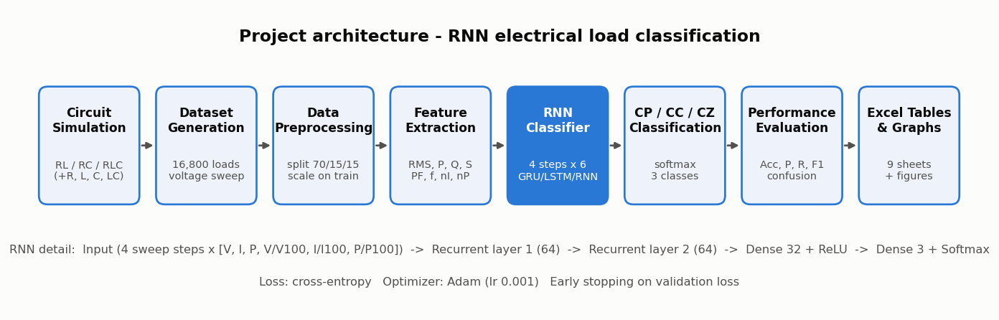

```
Circuit Simulation (RL, RC, RLC + R, L, C, LC)
   -> Dataset Generation (16,800 loads, 4-level voltage sweep)
   -> Data Preprocessing (stratified split 70/15/15, scaling fitted on training data only)
   -> Feature Extraction (Vrms, Irms, P, Q, S, PF, phase angle, |Z|, f, THD, sweep exponents)
   -> RNN Classifier (4 time steps x 6 features -> 2 recurrent layers -> dense -> softmax)
   -> CP / CC / CZ Classification
   -> Performance Evaluation (accuracy, precision, recall, F1, confusion matrix, error %)
   -> Excel Tables and Graphs (9 sheets)
```

---

## 2. Circuit simulation models (RL, RC, RLC)

Each load is a **series branch** fed from a 50 Hz supply. Steady state (phasor form):

| Circuit | Impedance Z | Phase angle phi | Current vs voltage |
|---|---|---|---|
| RL  | R + jwL | +atan(wL/R), between 0 and 90 deg | current **lags** |
| RC  | R - j/(wC) | -atan(1/(wCR)), between -90 and 0 deg | current **leads** |
| RLC | R + j(wL - 1/(wC)) | sign depends on whether wL > 1/(wC) | lags or leads |

with w = 2*pi*f. From the impedance you get |Z| = V/I, PF = cos(phi), P = V I cos(phi), Q = V I sin(phi),
S = V I.

The **switch-on transient** comes from Kirchhoff's voltage law, v(t) = R i + L di/dt + q/C, solved
numerically with `scipy.integrate.solve_ivp`. The code takes R, L and C from a real sample's |Z| and phase
angle. A built-in check confirms that the model reproduces that sample's |Z|.

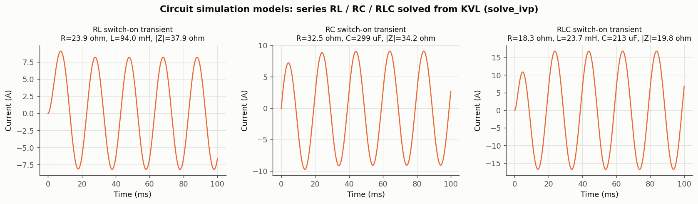

**How the load behaviour is modelled (ZIP model).** The power a load draws depends on the supply voltage
x = V / V_nominal:

S(V) = S_nom * (z*x^2 + i*x + p)

| Class | Dominant term | Current as V rises | Power as V rises |
|---|---|---|---|
| **CP** constant power | p | current **falls** (I proportional to 1/V) | stays flat |
| **CC** constant current | i | current **stays flat** | rises in proportion to V |
| **CZ** constant impedance | z | current **rises** (I proportional to V) | rises with V^2 |

Real loads behave this way. A heater or a lamp acts like CZ. Some electronic drivers and welding sets act like CC. An SMPS, a VFD-fed motor or an EV charger acts like CP.

---

## 3. Dataset generation procedure (from the dataset's own `Read me`)

- **16,800 loads** = 3 behaviour classes x 7 circuit types (R, L, C, RL, RC, LC, RLC) x 800 each.
  The classes are perfectly balanced: 5,600 CP, 5,600 CC and 5,600 CZ.
- The load size (S_nom) comes from a real **IIT Kanpur 5-minute load reading**. The time of day sets the grid stress from the
  **All-India demand curve**: heavy demand gives a lower supply voltage, V = 230 (1.03 - 0.10u), and a slightly lower
  frequency.
- **Conditions:** rows 1 to 8,400 are *normal*; rows 8,401 to 16,800 are *tough* (more noise, frequency drift and
  harmonic distortion).
- Each load is measured at **four supply levels (90 %, 95 %, 100 %, 105 %)**. This is the voltage-sweep test.
  V, I and P are recorded at each level, and the main features are taken at 100 %.
- Frequency per load comes from the `Source link` sheet (`frequency_used_Hz`) and is merged in by sample ID.

The sheets **RL Dataset**, **RC Dataset** and **RLC Dataset** (2,400 loads each) and **Complete Dataset**
(16,800 loads, all circuits) are in the Excel workbook. Every row also records whether it went to the training,
validation or test set.

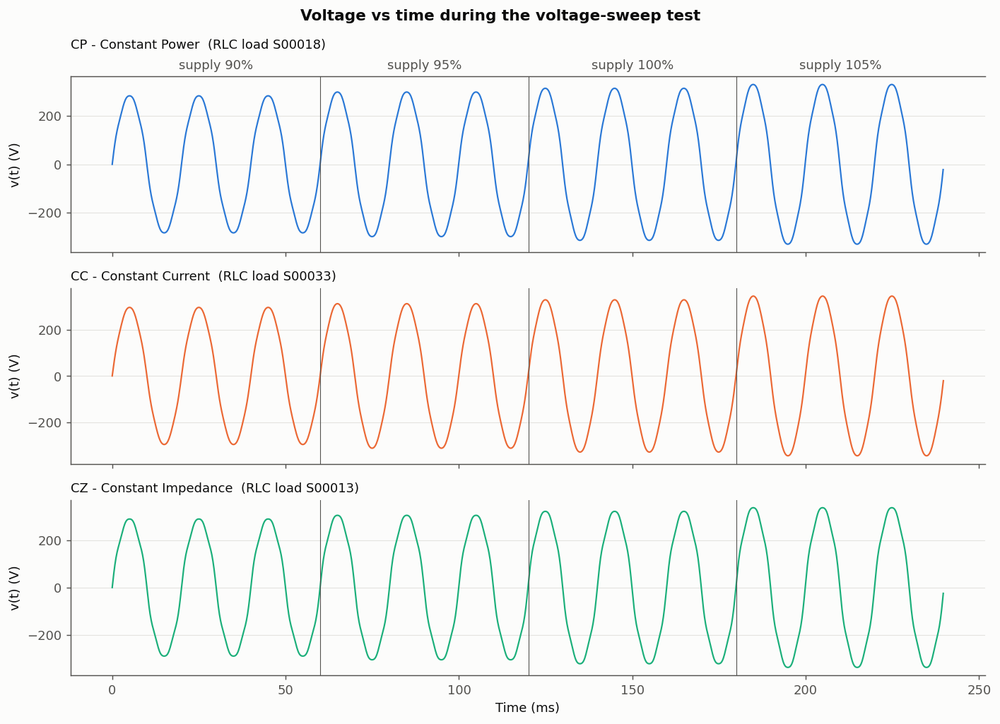
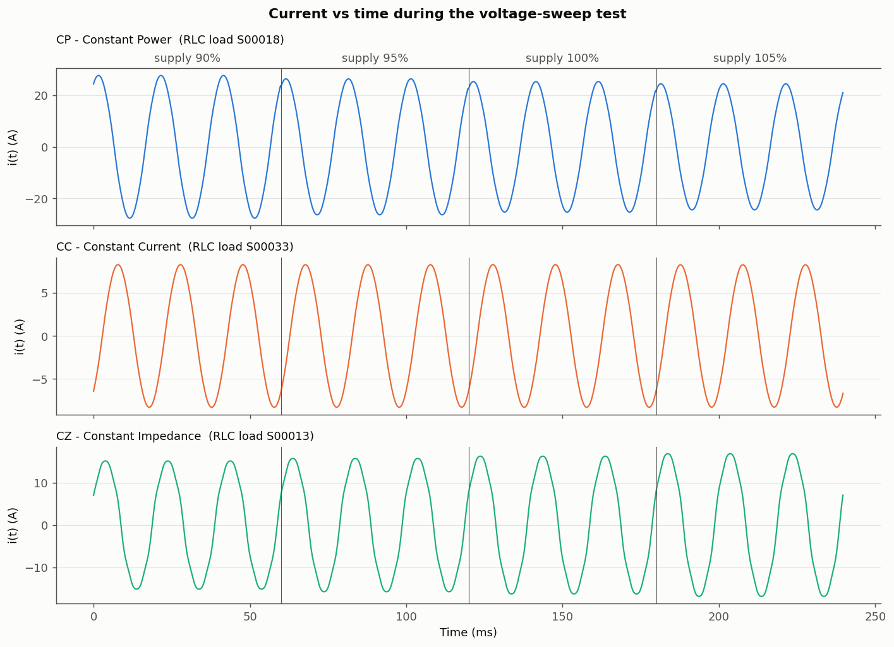
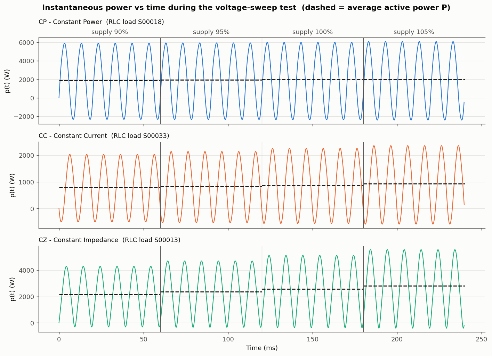

**What these three graphs show (the heart of the project).** All three loads see the same voltage staircase.
Their currents respond differently:

- **CP:** current *decreases* as the voltage steps up, so that the power stays at about 1,950 W.
- **CC:** current stays at the same amplitude, so power rises in step with the voltage.
- **CZ:** current *increases* with the voltage, so power rises fastest (with V^2).

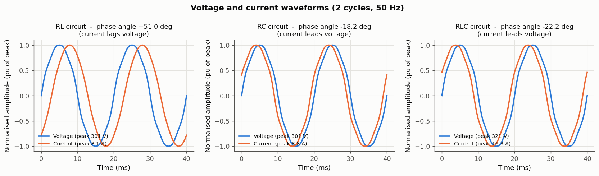

---

## 4. Data preprocessing (in simple language)

1. **Load and check.** The code reads the Excel file and joins frequency and condition by sample ID. It then checks that there are
   exactly 16,800 rows with no missing values and only the labels CP, CC and CZ.
2. **Split first, before anything else.** The loads are divided 70 % / 15 % / 15 % into training (11,760),
   validation (2,520) and test (2,520). The split is *stratified* on class x circuit x condition, so each set
   has the same mix of CP/CC/CZ, R...RLC and normal/tough. A code check confirms that no load appears in two sets.
3. **Scale using training data only.** Volts (~220), amps (~10) and watts (~1,000) are on very different
   scales, which makes neural networks train badly. Each input is converted to a z-score,
   (x - mean) / std. **The mean and std are computed from the training set only** and then applied to the
   validation and test sets. Computing them from the full data would let information from the test set leak into
   training. That is called **data leakage**, and it makes accuracy look better than it really is.
4. **Shape it as a time series for the RNN.** Each load becomes a short sequence of **4 time steps**, one per
   sweep level (90 % to 95 % to 100 % to 105 %). Each step carries 6 numbers:
   `[V, I, P, V/V100, I/I100, P/P100]`. The ratio columns remove the load's size, so that a 1 kW CP load and a
   5 kW CP load look the same to the network.
5. **The test set stays locked.** The test set is not used for training, for picking the model or for tuning. It is used
   only once, at the very end.

---

## 5. Feature extraction (in simple language)

Sheet **Feature Extraction** (one row per load):

| Feature | Unit | Meaning |
|---|---|---|
| Vrms, Irms | V, A | "Heating-equivalent" strength of voltage and current |
| Active power P | W | Power actually converted to work or heat |
| Reactive power Q | var | Power bouncing back and forth in L and C (positive = inductive, negative = capacitive) |
| Apparent power S | VA | Vrms x Irms, what the cables and transformer must carry |
| Power factor PF | - | P/S, how much of S is useful |
| Phase angle phi | deg | How far the current is shifted from the voltage |
| Impedance \|Z\| | ohm | Vrms / Irms |
| Frequency, frequency deviation | Hz | Supply frequency and its offset from 50 Hz |
| THD_V, THD_I | pu | Harmonic distortion of voltage and current |
| dV, dI, dP over sweep | % | How much V, I and P changed from the 90 % step to the 105 % step |
| **Current exponent nI** | - | Slope of ln(I) against ln(V) over the sweep: **CP = -1, CC = 0, CZ = +1** |
| **Power exponent nP** | - | Slope of ln(P) against ln(V) over the sweep: **CP = 0, CC = 1, CZ = 2** |

nI and nP sum up the "variation over time" of voltage and current in two numbers. Each one is a least-squares slope over the 4 sweep points.

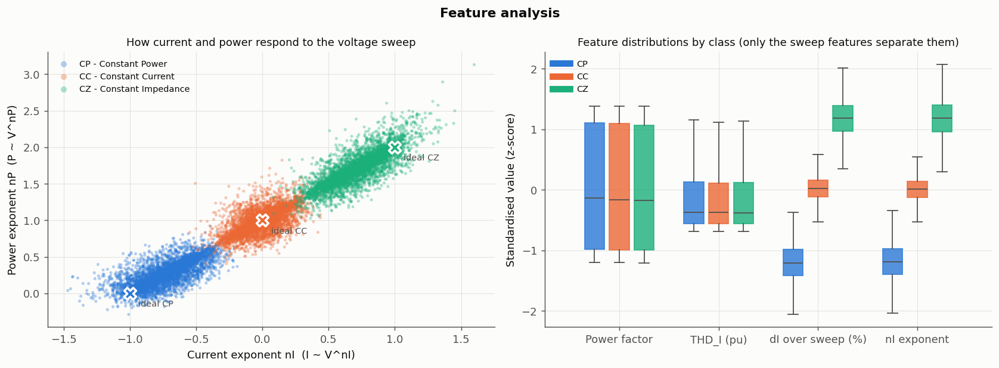

**What the feature graph says.** The left plot shows three clear clouds sitting near the ideal ZIP points. The right
plot shows that **PF and THD do not separate the classes at all**: CP, CC and CZ have the same distributions. Only the
*voltage-response* features separate them. This makes physical sense. Whether a load is RL or RC sets its phase angle,
but whether it is CP, CC or CZ is set by **how its current reacts when the voltage changes**. That is why the RNN is
given the sweep sequence.

---

## 6. RNN classifier architecture

```
Input layer      : 4 time steps x 6 features  (V, I, P, V/V100, I/I100, P/P100)
Recurrent layer 1: 64 units  (tanh for the simple RNN; gated cells for LSTM/GRU)
Recurrent layer 2: 64 units, dropout 0.2 between layers
Dense layer      : 32 units, ReLU, dropout 0.2      (fed from the last time step)
Output layer     : 3 units -> softmax -> P(CP), P(CC), P(CZ)
```

| Setting | Choice | Why |
|---|---|---|
| Loss | Cross-entropy | Standard loss for multi-class classification with softmax outputs |
| Optimizer | Adam, lr = 0.001, weight decay 1e-5 | Adapts the step size for each weight; stable |
| Batch size | 128 | |
| Epochs | up to 150, **early stopping** (patience 20) on validation loss | Stops before over-fitting; keeps the best weights |
| Seed | 42 | Same results every run (checked: two runs gave identical numbers) |

**Three recurrent cells were trained:** a simple RNN, an LSTM and a GRU. The one with the highest **validation**
accuracy was selected (the LSTM). Choosing on validation rather than test keeps the test result honest.

**Why an RNN suits this problem.** The RNN reads the sweep one step at a time and carries a memory (its hidden
state) from step to step. It can therefore learn rules like "the voltage went up, and the current went down, so this is CP" directly from
the raw V and I readings, without being told the ZIP equations.

---

## 7. Training and testing results

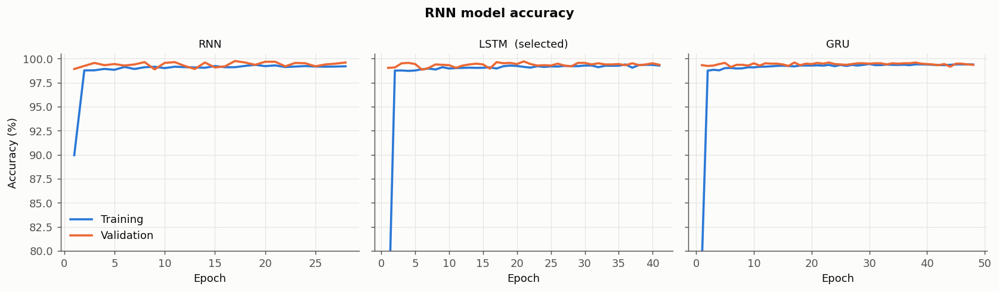
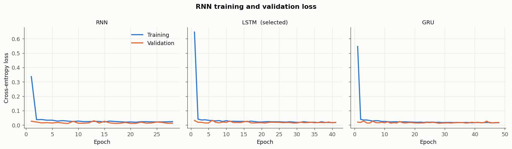

Training and validation loss fall together and level off at about 0.02. The two curves do not drift apart, which means
**no over-fitting**. Early stopping ended training at epoch 28 (RNN), 41 (LSTM) and 48 (GRU).

### Final result on the unseen test set (2,520 loads), selected model = LSTM

| Metric | Value | Target |
|---|---|---|
| **Accuracy** | **98.85 %** | at least 95 % |
| Precision (macro) | 98.86 % | |
| Recall (macro) | 98.85 % | |
| F1-score (macro) | 98.85 % | |
| **Classification error** | **1.15 %** | under 5 % |

**Both targets are met.**

### Per-class

| Class | Precision | Recall | F1 | Test loads |
|---|---|---|---|---|
| CP | 99.88 % | 99.29 % | 99.58 % | 840 |
| CC | 97.43 % | 99.17 % | 98.29 % | 840 |
| CZ | 99.28 % | 98.10 % | 98.68 % | 840 |

### Confusion matrix (rows = actual, columns = predicted)

| | Pred CP | Pred CC | Pred CZ |
|---|---|---|---|
| **CP** | 834 | 6 | 0 |
| **CC** | 1 | 833 | 6 |
| **CZ** | 0 | 16 | 824 |

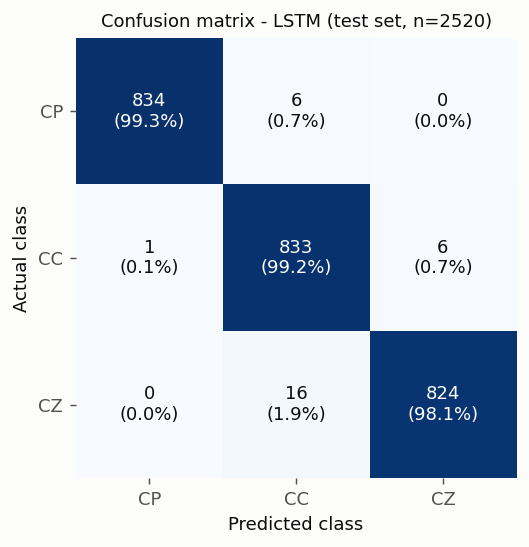

**Reading it:** all 29 errors involve **CC**. CP is never confused with CZ, in either direction. This is physical:
CC sits *between* CP (nI = -1) and CZ (nI = +1). A CZ-dominated load with a sizeable constant-current share (the
dataset allows a dominant weight as low as 0.65) is genuinely close to the CC boundary.

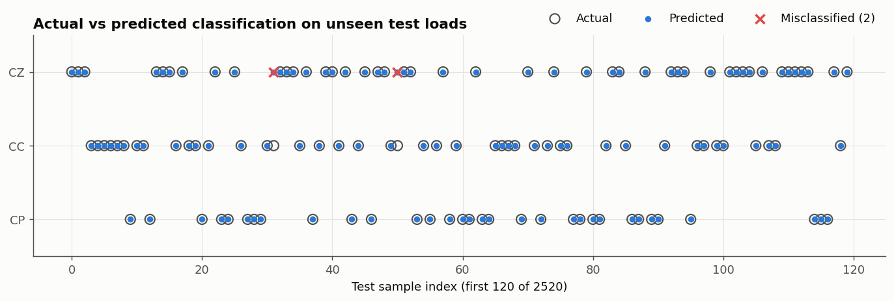

---

## 8. Classification performance comparison

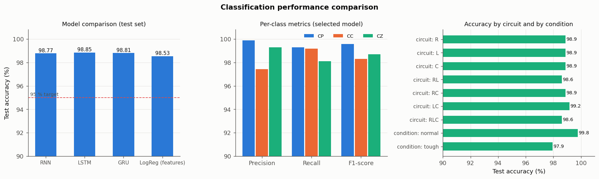

| Model | Validation acc. | Test acc. | F1 | Error |
|---|---|---|---|---|
| Simple RNN | 99.64 % | 98.77 % | 98.77 % | 1.23 % |
| **LSTM (selected)** | 99.72 % | **98.85 %** | 98.85 % | 1.15 % |
| GRU | 99.52 % | 98.81 % | 98.81 % | 1.19 % |
| Logistic regression on hand-made features | n/a | 98.53 % | 98.53 % | 1.47 % |

| Group (LSTM, test set) | Accuracy |
|---|---|
| R / L / C / RC | 98.9 % each |
| RL / RLC | 98.6 % |
| LC | 99.2 % |
| **Normal condition** | **99.8 %** |
| **Tough condition** (noise, drift, distortion) | **97.9 %** |

**Honest observations**

- The three recurrent cells are within 0.1 % of each other, which is a handful of test loads. The choice of
  cell hardly matters here, because the sequence is short (4 steps).
- A simple logistic regression on the hand-made nI and nP features comes within 0.3 % of the RNN. Once the
  physics is turned into the right features, the problem is almost linearly separable. The RNN's advantage is that it
  reaches the same accuracy **from the raw V/I/P readings, without anyone telling it about ZIP exponents**.
- Accuracy is almost the same for every circuit type. RL, RC or RLC does not change how hard the problem is, which
  agrees with the feature analysis.
- **Measurement quality matters most:** accuracy drops from 99.8 % on clean data to 97.9 % on tough data. Noise
  and distortion are the main source of errors, and that is the main limit for real field use.
- Validation accuracy (99.7 %) is slightly higher than test accuracy (98.85 %). That is the normal small optimism
  from picking the best model on validation. The test number is the one to report.

---

## 9. Excel workbook (`outputs/RNN_Load_Classification_Results.xlsx`)

| Sheet | Contents |
|---|---|
| Complete Dataset | 16,800 loads, all features with units, label, circuit, condition, data split |
| RL Dataset / RC Dataset / RLC Dataset | 2,400 loads each |
| Feature Extraction | All extracted features incl. nI, nP, sweep variations, frequency deviation |
| Actual vs Predicted | 2,520 test loads: actual, predicted, class probabilities, confidence; **wrong rows highlighted red** |
| RNN Performance Metrics | Summary, model comparison, per-class metrics, accuracy by circuit/condition, full per-epoch training history |
| Confusion Matrix | Counts and row-% tables plus the confusion-matrix image |
| Graphical Analysis | All 12 figures with captions |

All headers are formatted and carry units. Panes are frozen and filters are on.

---

## 10. Step-by-step explanation in simple electrical-engineering language

1. **Build the circuits.** Take a resistor, an inductor and a capacitor in series (RL, RC, RLC) and connect
   them to a 230 V, 50 Hz supply. The inductor makes the current lag the voltage, the capacitor makes it lead, and the
   resistor sets how much real power is used.
2. **Decide how each load reacts to voltage.** Real loads are not just R, L and C. Some, like a heater, draw
   more current when the voltage rises (CZ). Some hold their current steady (CC). Some, like an SMPS or an EV charger, keep their
   power steady and so draw *less* current when the voltage rises (CP). This is the ZIP model.
3. **Test each load like a lab experiment.** Step the supply 90 % to 95 % to 100 % to 105 % and write down V, I
   and P at each step. Do this for 16,800 different loads, at different times of day, with half of them under poor supply
   conditions (noise, drifting frequency, harmonics).
4. **Compute the usual meter readings:** Vrms, Irms, P, Q, S, power factor, phase angle, impedance, frequency
   and THD. These are the same quantities a power-quality analyser shows.
5. **Notice the key clue.** Power factor and phase angle tell you *what the circuit is* (RL, RC, RLC). They
   do not tell you *how the load behaves*. The behaviour shows only in **how the current changes when the
   voltage changes**. That is captured in the exponents nI and nP.
6. **Prepare the data fairly.** Set aside 15 % of loads as a sealed exam (the test set) and 15 % as practice exams
   (the validation set). Train on the remaining 70 %. Scale the numbers using only the training loads, so the exam
   answers never leak in.
7. **Teach the RNN.** Feed it the four sweep readings in order. Like an engineer watching a meter while turning
   a variac, it remembers what happened at the previous step and judges the trend. It outputs a probability
   for CP, CC and CZ.
8. **Grade it on the sealed exam.** On 2,520 loads it has never seen, the RNN is right **98.85 %** of the
   time, with **1.15 % error**. That meets the 95 % and 5 % targets.
9. **Understand the mistakes.** Every error involves CC, the "in-between" behaviour, and most happen
   under poor supply conditions. CP and CZ, the two extremes, are never mixed up.
10. **Report everything** in one Excel workbook with tables, units and graphs, so the results can be checked
    and reproduced. Running `python rnn_load_classifier.py` again gives the same numbers.

---

## 11. Limitations and next steps

- The data is **simulated**. Validation against measured field loads (for example a real lab variac sweep) is the
  natural next step.
- The waveform figures are reconstructed from RMS, phase and THD values (the harmonic split is assumed). The classifier
  itself does not use them.
- Real loads are often mixtures (ZIP weights near a third each). The dataset's dominant weight is at least 0.65, so
  strongly mixed loads are outside what was tested.
- The voltage sweep needs a controllable supply or natural voltage variation. On a stiff grid with very little
  voltage change, the classifier would have little to go on.
